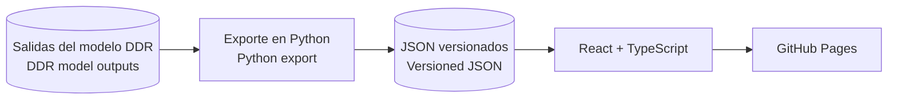

<div align="center">

# DDR Dashboard · Tablero de pronóstico de demanda

**Dashboard interactivo de pronóstico de demanda, inventario e impacto en dinero sobre M5 (Walmart)**<br>
*Interactive demand forecasting, inventory and business-impact dashboard on Walmart's M5 dataset*


**[Ver el tablero · Open the dashboard](https://<usuario>.github.io/<repositorio>/)**

<!-- Imagen principal: guardar una captura del tablero en docs/img/hero.png y quitar este comentario.

-->

</div>

---

## Contenido · Contents

1. [El problema · The problem](#el-problema--the-problem)
2. [Módulos · Modules](#módulos--modules)
3. [Cómo se alimenta · How it is fed](#cómo-se-alimenta--how-it-is-fed)
4. [Reglas de la casa · House rules](#reglas-de-la-casa--house-rules)
5. [Estructura · Repository structure](#estructura--repository-structure)
6. [Cómo reproducirlo · Getting started](#cómo-reproducirlo--getting-started)
7. [Hoja de ruta · Roadmap](#hoja-de-ruta--roadmap)
8. [Proyecto hermano · Sister project](#proyecto-hermano--sister-project)
9. [Autor y licencia · Author & license](#autor-y-licencia--author--license)

---

## El problema · The problem

Un modelo de pronóstico que vive en un notebook tiene la misma influencia sobre el inventario que un horóscopo guardado en un cajón. El gerente que decide cuánto reponer no abre notebooks, no lee WRMSSE y no tiene por qué hacerlo. Necesita ver, en un solo lugar y con la cabeza fría, qué productos sostienen el negocio, cómo se han comportado y cuánto cuesta equivocarse.

> **EN.** A forecasting model that lives in a notebook has as much influence on inventory as a horoscope kept in a drawer. The manager deciding how much to reorder does not open notebooks, does not read WRMSSE, and should not have to. What is needed is one place to see, calmly, which products carry the business, how they have behaved, and what being wrong costs.

**DDR Dashboard** es el tablero de **pronóstico de demanda** (*demand forecasting dashboard*) que pone en pantalla los resultados de [Demand Driven Replenishment](https://github.com/<usuario>/<repositorio-modelo>): la segmentación ABC × XYZ de 3.049 productos de Walmart, la historia de ventas de cada uno, el pronóstico de los 517 productos clave frente a la línea base y el impacto en dinero sobre el **inventario** y el **abastecimiento**. Está pensado para la gerencia regional y la de operaciones.

> **EN.** **DDR Dashboard** is the **demand forecasting dashboard** that puts the results of [Demand Driven Replenishment](https://github.com/<usuario>/<repositorio-modelo>) on screen: the ABC × XYZ segmentation of 3,049 Walmart products, each product's sales history, the forecast for the 517 key products against the baseline, and the money impact on **inventory** and **supply chain** decisions. It is built for regional and operations managers.

La meta: que la conversación sobre reposición pase de "el año pasado vendimos esto" a "con este nivel de servicio, esto es lo que dejamos de perder y lo que dejamos de acumular". Todo el tablero recorre el año de prueba, periodo a periodo de 4 semanas, como si las decisiones se hubieran tomado en su momento.

> **EN.** The goal: to move the replenishment conversation from "this is what we sold last year" to "at this service level, this is the sales loss we avoid and the stock we stop piling up". The whole dashboard replays the test year, period by period, as if each decision had been made at the time.

---

## Módulos · Modules

| Módulo · Module | Qué responde | What it answers |
|---|---|---|
| **Inicio** · *Home* | Bienvenida y entrada al recorrido. | Welcome and entry point. |
| **Segmentos** · *Segments* | ¿Qué productos sostienen el ingreso y cuáles venden de forma pareja? Vitales, Útiles y Complementarios × continuos, recurrentes y ocasionales (ABC × XYZ), radar de perfiles y embudo de 3.049 a 517. | Which products carry the revenue and which sell steadily? Vital, Useful and Complementary × continuous, recurring and occasional (ABC × XYZ), profile radar and the 3,049 → 517 funnel. |
| **Artículo** · *Product* | ¿Cómo se ha comportado este producto? Unidades cada 4 semanas con el pronóstico frente a la línea base, el ahorro del artículo y, en el detalle, el cálculo, el error y la tabla exportable. | How has this product behaved? Units every 4 weeks with the forecast against the baseline, the product's savings and, in the detail page, the calculation, error and an exportable table. |
| **Impacto** · *Impact* | ¿Cuánto vale pronosticar mejor? Dos maneras de aprovecharlo: liberar capital o recuperar ventas, según el % de demanda atendida, por grupo y por producto. | What is a better forecast worth? Two ways to use it: free up capital or recover sales, by share of demand served, per group and per product. |
| **Cómo usar** · *How to use* | Para qué sirve cada sección y glosario. | What each section is for, plus glossary. |

Un adelanto: con la misma disponibilidad del 95 %, el inventario en exceso cae un 77 % frente a repetir el año anterior. El resto de la historia está en el módulo de impacto.

> **EN.** A sneak peek: at the same 95% service level, excess inventory drops 77% versus repeating last year. The rest of the story is in the impact module.

---

## Cómo se alimenta · How it is fed




---

## Reglas de la casa · House rules

- **El tablero muestra, no recalcula.** Segmentación, pronóstico e impacto se leen tal cual del modelo. *The dashboard displays; it does not recompute.*
- **Un solo pronóstico en pantalla.** El tablero muestra un único pronóstico y no menciona el método. *One forecast on screen; the method is not shown.*
- **Lecturas derivadas rotuladas.** Fuera del 95 %, las cifras de impacto se leen entre puntos de la curva exportada y se marcan como calculadas en el sitio. *Readings off the 95% point are interpolated from the exported curve and labeled as such.*
- **Precio de venta, no margen.** Una etiqueta siempre visible en la barra superior lo dice. *An always-visible label in the top bar says every money figure is at sale price, not margin.*
- **Pronóstico para quien lo tiene.** Los 3.049 productos tienen historia; solo los 517 modelados tienen pronóstico. El resto recibe un aviso honesto y un enlace al embudo. *All 3,049 products have history; only the 517 modeled ones have a forecast. The rest get an honest notice and a link to the funnel.*
- **Un dato ausente se dice.** Se muestra como "no disponible", nunca como cero. *A missing value says so: "not available", never zero.*

---

## Estructura · Repository structure

```
.
├── docs/
│   ├── diseno/                  # Guía visual y pantallas · Visual guide and screens
│   └── mapa_flujo_datos.md      # Contrato con las salidas del modelo · Data contract
├── export/                      # Exportación en Python · Python export script
├── public/
│   └── data/                    # JSON exportados y versionados · Exported, versioned JSON
├── src/                         # Aplicación React + TypeScript · React + TypeScript app
├── .env.example                 # DATA_PROJECT_ROOT
├── LICENSE
├── package.json
└── README.md
```

---

## Cómo reproducirlo · Getting started

**1. Exportar los datos · Export the data.** Requiere una copia local del proyecto DDR con sus salidas generadas. *Requires a local copy of the DDR project with its outputs already generated.*

```bash
cp .env.example .env            # Definir DATA_PROJECT_ROOT · Set DATA_PROJECT_ROOT
python export/export.py         # Escribe los JSON en public/data · Writes JSON to public/data
```

**2. Correr el tablero · Run the dashboard.**

```bash
npm install
npm run dev
```

**3. Publicar · Deploy.** Cada push a la rama principal publica el sitio en GitHub Pages. *Every push to the main branch deploys the site to GitHub Pages.*

---

## Hoja de ruta · Roadmap

- [ ] Vistas con pronóstico por tienda y por región · *Store- and region-level forecast views*
- [ ] Pronóstico hacia adelante, más allá del año de test · *Forward-looking forecasts beyond the test year*
- [ ] Productos fuera de la segmentación objetivo · *Products outside the target segments*

---

## Proyecto hermano · Sister project

**[Demand Driven Replenishment](https://github.com/<usuario>/<repositorio-modelo>)**: el modelo, el análisis y los hallazgos detrás de cada cifra de este tablero. *The model, analysis and findings behind every number on this dashboard.*

---

## Autor y licencia · Author & license

**José Gregorio Salas Bolívar** · Data scientist

Licencia: ver [LICENSE](LICENSE). · *License: see [LICENSE](LICENSE).*
